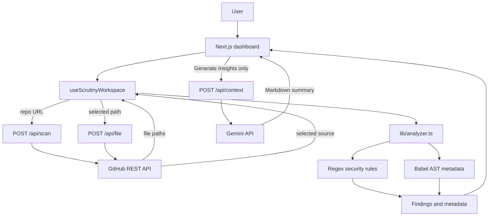
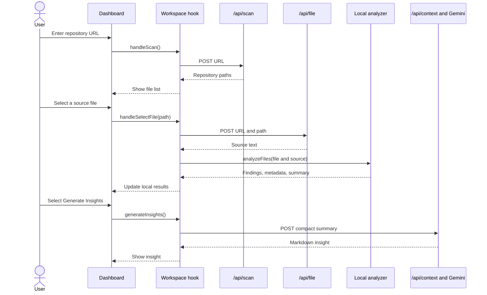
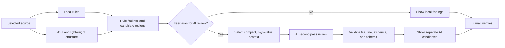

# Scrutiny Project Documentation

## 1. Purpose

Scrutiny is a local-first source-code review tool. It finds selected code patterns, extracts code structure, and builds a small repository risk summary. A user can ask Gemini to summarize the local results.

Scrutiny is a learning and review aid. It is not a complete security scanner. It does not prove that a finding is exploitable. It can miss real vulnerabilities and report safe code as risky. A developer or security reviewer must confirm each result.

The current application uses both deterministic rules and AI, but it does **not** use AI to find vulnerabilities. Local rules create findings. The user can then send a compact summary to Gemini. This is hybrid analysis and explanation, not hybrid vulnerability detection.

## 2. Design Goals

The implementation follows these goals:

- Run predictable checks without an AI call.
- Fetch one source file only when the user selects it.
- Keep findings and metadata in the browser during the current page session.
- Send compact analysis data to Gemini only after the user selects **Generate Insights**.
- Keep paste mode useful without a GitHub repository.
- Show evidence that a reviewer can inspect.

The design does not currently provide complete data-flow analysis, whole-program analysis, CI scanning, patch generation, or a vulnerability guarantee.

## 3. System Map



### 3.1 Main folders

| Path | Purpose |
| --- | --- |
| `app/page.tsx` | Creates the workspace hook and passes state to the dashboard. |
| `app/hooks/useScrutinyWorkspace.ts` | Owns scan state, selected-file state, local analysis, paste mode, and insight cache. |
| `app/components/ScrutinyDashboard.tsx` | Renders scan controls, file selection, selected-file content, findings, summaries, and AI insights. |
| `app/api/scan/route.ts` | Validates a GitHub repository URL and returns file paths. |
| `app/api/file/route.ts` | Validates a repository URL and path, then returns one file's text. |
| `app/api/context/route.ts` | Sends the submitted analysis summary to Gemini and returns Markdown. |
| `app/api/explain/route.ts` | A separate Gemini explanation endpoint. The current dashboard does not call it. |
| `lib/github.ts` | Parses GitHub repository URLs and calls the GitHub REST API. |
| `lib/analyzer.ts` | Runs security patterns, parses JS/TS syntax, and builds summaries. |
| `lib/fileIntelligence.ts` | A separate AST helper. The selected-file File Intelligence panel is not active in the current UI. |
| `demo/` | Example source files for manual review and scanner checks. |

## 4. Runtime Workflows

### 4.1 Repository mode



The repository scan fetches paths. It does not download or analyze every source file. Each file is fetched and analyzed when the user selects it. The repository totals therefore describe **opened and analyzed files**, except `fileCount`, which describes discovered paths.

### 4.2 Paste mode

Paste mode sends the pasted path and source to `analyzeFiles` in the browser. It does not need the GitHub API. Local rule and metadata results appear without Gemini. The user can separately request insights. That request sends compact analyzer output to `/api/context`.

## 5. Workspace State

`useScrutinyWorkspace` is the state owner. The dashboard receives values and event handlers as props.

Important state includes:

- `repoUrl` and `files`: current repository and discovered paths.
- `selectedFile` and `fileContent`: selected path and loaded source text.
- `analysis`: accumulated `AnalysisResult` for files opened in this page session.
- `selectedFinding`: the finding selected in the user interface.
- `devMode`, `devCode`, and `devFilePath`: paste-mode state.
- `repoInsights`, `insightsLoading`, and `insightsError`: AI result state.
- `insightsCache`: in-memory result cache for this page session.

`analyzeAndStore` analyzes a selected file, then merges its metadata and findings by file path and finding ID. Re-opening a file replaces that file's metadata and finding IDs. `buildRepoSummary` then recalculates the repository summary.

The AI cache key uses a short integer hash of the URL, mode, and compact payload. The cache is not persistent. A page reload clears it. A short hash can collide, so a production cache should use a stable cryptographic digest or store and compare the full normalized payload.

## 6. Local Analyzer

### 6.1 File selection

`analyzeFiles` accepts values in this form:

```ts
type InputFile = {
  file: string
  content: string
}
```

The analyzer skips empty paths, empty content, unsupported extensions, and configured ignored path segments. Its supported extensions are JavaScript, JSX, TypeScript, TSX, Python, PHP, C, C++, C/C++ headers, Java, and C#.

The current security rules are selected by extension. This support list does not mean that every extension has equivalent coverage. AST metadata is produced by Babel and applies to JavaScript and TypeScript-family source. Rule scanning also has language-specific regular expressions for several other languages.

### 6.2 Rule-based findings

The scanner processes one source line at a time. It skips lines that start with common comment markers and lines that contain `scan-ignore`. It tests the rules mapped to that file extension. It records the first matching rule on each line.

Current rule families include:

| Language or group | Current pattern families |
| --- | --- |
| All supported files | Hardcoded secret assignments. |
| JavaScript and TypeScript | Process execution, shell use, `eval`, unsafe HTML insertion, `document.write`, and prototype keys. |
| Python | Process execution, unsafe pickle/YAML loading, dynamic evaluation, formatted SQL, template rendering, and path use. |
| PHP | Process execution, SQL interpolation, dynamic includes, request-variable extraction, deserialization, and evaluation. |
| C and C++ | Unsafe copy functions, non-literal format strings, and a simple allocation-size multiplication pattern. |
| Java | Process execution, path construction, and SQL concatenation. |
| C# | Process execution, SQL command construction, and path construction. |

A `Finding` contains an ID, file path, line, severity, rule title, matched text, short code, nearby context, and a generated security story. The story builder uses simple source and sink patterns. It does not trace values through a full program.

### 6.3 Severity and risk

Rules assign one of four severity labels: `CRITICAL`, `HIGH`, `MEDIUM`, or `LOW`.

The current score uses these weights:

| Severity | Weight |
| --- | ---: |
| Critical | 10 |
| High | 5 |
| Medium | 2 |
| Low | 1 |

The file and repository risk scores are sums of finding weights. They are sorting signals. They are not calibrated probabilities, CVSS scores, or estimates of exploit likelihood. One finding can also represent a false positive.

### 6.4 AST metadata

For JS/TS-family files, `lib/analyzer.ts` uses `@babel/parser` and a visitor to collect imports, exports, functions, classes, call edges, framework hints, entry points, and dependencies. It also counts basic source metrics and infers a module role from path names, imports, framework signals, and content keywords.

The role and responsibility labels are heuristics. They can be wrong. The active workspace flow uses the analyzer in `lib/analyzer.ts`. The separate `lib/fileIntelligence.ts` helper is not currently rendered in the selected-file panel.

## 7. Structured Results

### 7.1 `AnalysisResult`

`AnalysisResult` groups three outputs:

- `findings`: local security rule results.
- `metadata`: per-file structure and inferred roles.
- `repoSummary`: totals, module groups, hotspots, frameworks, and dependencies.

### 7.2 `RepoSummary`

`buildRepoSummary` groups analyzed files by inferred module purpose. It totals finding severity and risk. It creates up to five file hotspots ordered by risk. These values change as the user opens more files.

### 7.3 `CompactAiPayload`

`buildCompactAiPayload` reduces data before an AI request:

- It includes overall file and finding counts, severity totals, score, frameworks, and hotspots.
- It includes up to eight module summaries.
- It includes up to 25 analyzed files.
- It includes up to eight findings for each included file.
- It omits full source text and most finding context.

These limits reduce prompt size. They can also omit lower-ranked files or findings. Gemini receives the compact payload only after the user asks for insights.

## 8. API Routes

### `POST /api/scan`

Input:

```json
{ "url": "https://github.com/owner/repository" }
```

The route checks the URL and calls `fetchRepoTree`. It returns `{ success, files }` or an error message. The GitHub helper requests repository metadata to find the default branch, then requests its recursive tree.

### `POST /api/file`

Input:

```json
{ "url": "https://github.com/owner/repository", "path": "src/index.ts" }
```

The route checks both fields and the GitHub URL. It fetches one file through the GitHub Contents API. The helper expects Base64 content and decodes it as UTF-8.

### `POST /api/context`

Input:

```json
{
  "url": "https://github.com/owner/repository",
  "mode": "repo",
  "analysis": { "repo": {}, "modules": [], "files": [] }
}
```

The route checks that the URL is a non-empty string and that `analysis` is an object. It serializes the analysis into a Gemini prompt. Gemini returns Markdown. The route does not return structured findings or validate AI claims against source code.

### `POST /api/explain`

This route accepts one finding and sends its title, file, line, code, and snippet to Gemini. It is not used by the current dashboard. The local `explanations` table in `lib/analyzer.ts` supplies fixed explanations for known rule types.

## 9. Rule-Based vs AI-Based Detection

### 9.1 Rule-based analysis

Rules include regular expressions, syntax checks, data-flow rules, and semantic queries. Their behavior is repeatable for the same input and rule version. A rule can provide direct evidence and a clear location. Rules can run locally with low cost.

Simple patterns have important limits. They can miss code when syntax differs from the pattern. They can flag safe code when the pattern appears in a safe context. A line-by-line regular expression usually cannot prove that user input reaches a dangerous operation. It also has limited understanding of types, control flow, sanitizers, or project-specific behavior.

Scrutiny's current regular expressions are a small set of heuristics. They are not comparable to a mature data-flow engine such as CodeQL.

### 9.2 AI-based analysis

A language model can reason over code and context that was not encoded as one exact rule. It can explain why a pattern may be risky and help a reviewer triage results. Its output is probabilistic. It can miss a bug, invent a path, misread code, or change its answer between requests. It can use more time and money than local checks. Source code sent to a hosted model also leaves the local process.

A language model response is not proof. The app must validate any proposed file path, line, severity, and evidence against the source before it presents an AI result as a finding.

### 9.3 Research conclusion

There is no single method that is best for every language, vulnerability, dataset, or workflow.

The available studies show why results need care:

- Gao and colleagues introduced VulBench and compared 16 language models with six deep-learning models and static analyzers. They report that several LLMs outperform traditional deep-learning approaches. This result does not prove that LLMs beat all static analyzers in production.
- Yu and colleagues studied seven programming languages. Their preliminary result reports that CodeT5P performed best in their multilingual setup. This shows that a general-purpose LLM is not always the strongest model.
- Ince and colleagues reviewed LLM tools for smart-contract security against Slither and Mythril. They report that the tested LLM tools were not ready to replace established tools. This study covers smart contracts, so do not treat its result as a direct measure of all application code.
- Yang and colleagues report that program-analysis context can improve LLM detection in their experiments. This supports a hybrid design, but one paper does not establish a universal result.

The studies use different datasets, languages, prompts, models, and scoring methods. Some use vulnerable functions or benchmark examples. Results can change when the tool analyzes full repositories, new code, or different languages. Use these results as evidence for testing a hybrid design, not as a guarantee of accuracy.

### 9.4 Recommended approach for Scrutiny

Use deterministic local analysis as the first pass. Use AI as a limited second opinion when a user asks for it. Keep each result tied to code evidence.



This is a recommended future design. The current `/api/context` call summarizes local results. It does not perform this second-pass vulnerability search.

If AI detection is added, keep AI candidates separate from rule findings. Require evidence that points to a real file and line. Ask for a structured response. Reject invalid output. Do not let model-generated severity change the original rule severity. Apply request limits, file limits, and explicit user control.

## 10. Evaluation Plan

Do not compare tools by counting how many alerts they produce. More alerts can mean more false positives.

Create a labeled test set with vulnerable and safe examples. Cover each supported language and each rule family. Include code with different names, formatting, and safe fixes. Keep some projects out of the development set. This reduces memorization and benchmark leakage.

Compare three modes:

1. Rule-only baseline.
2. AI-only review.
3. Hybrid review.

Record these measures:

- Precision: correct alerts divided by all alerts.
- Recall: found vulnerabilities divided by all labeled vulnerabilities.
- F1: balance of precision and recall.
- False alerts per thousand lines of code.
- Detection rate by language and vulnerability family.
- Cost per repository and per thousand lines.
- Request time and response failure rate.
- Reviewer time to confirm or reject a result.

Use the same source set and vulnerability labels for each mode. Record model name, model version, prompt, temperature, token size, and rule version. Report results by language and vulnerability family. Do not hide failed requests or unsupported files.

## 11. Security and Privacy Notes

- GitHub access uses the server-side `GITHUB_TOKEN` environment variable when it exists.
- Do not place GitHub or Gemini secrets in browser code.
- Gemini is called only by explicit user action in the current insight flow.
- Repo insight requests send compact metadata and selected finding evidence, not full source files.
- A future AI detection mode may need to send source snippets. Show this clearly and get user consent.
- A public service needs rate limits, request size limits, access controls, and abuse monitoring.
- Validate all route input at runtime. TypeScript types do not validate JSON from a network request.
- Treat repository code and model output as untrusted input. Render Markdown with sanitization controls appropriate to the chosen renderer.

## 12. Setup and Commands

Requirements: Node.js and npm.

```bash
npm install
npm run dev
```

Open `http://localhost:3000`.

Set optional credentials in `.env.local`:

```env
GITHUB_TOKEN=your_github_token
GEMINI_API_KEY=your_gemini_api_key
```

`GITHUB_TOKEN` can raise the GitHub API rate limit and may allow private repository access. `GEMINI_API_KEY` is needed for **Generate Insights**. Keep both values private.

Project scripts:

```bash
npm run dev
npm run lint
npm run build
npm run start
```

There is no dedicated automated test suite in the current package scripts. Use `demo/` files for manual checks, and add labeled tests before relying on detection metrics.

## 13. Known Limits and Work Items

Current limits:

- A recursive regular-expression scan is not a complete taint or control-flow analysis.
- The scanner records only the first matching rule on a line.
- Comment skipping checks line prefixes. It does not parse comments in every language.
- Source and sink recognition uses a small list of text patterns.
- AST support is strongest for JavaScript and TypeScript-family files. Other supported extensions use rules but do not gain the same Babel metadata.
- A discovered file is not analyzed until it is opened.
- The UI has a list display limit. The compact AI payload has its own limits.
- The risk score is a ranking value, not a probability or standard severity score.
- The insights endpoint summarizes local results. It does not add verified vulnerability findings.
- `lib/fileIntelligence.ts` is separate from the active local analysis output and is not currently wired into the selected-file panel.
- API request bodies use some TypeScript casts. Add runtime schema validation before wider deployment.

Recommended next work:

1. Add unit tests for each rule. Include both unsafe and safe examples.
2. Measure precision and recall before expanding rule coverage.
3. Improve rules with AST and source-to-sink analysis where feasible.
4. Add an optional AI second pass with a strict output schema and evidence checks.
5. Add request limits, runtime validation, and model cost telemetry.
6. Decide whether to consolidate or remove the unused `lib/fileIntelligence.ts` module.

## 14. Research and Technical References

1. NIST, *Secure Software Development Framework (SSDF) Version 1.1*, SP 800-218, February 2022. The guide sets secure development practices. It does not say that one scanner method is best. [NIST publication](https://csrc.nist.gov/pubs/sp/800/218/final)
2. GitHub, *About CodeQL*. The documentation describes code databases with syntax, data-flow, and control-flow information, plus queries that can report source-to-sink paths. [CodeQL documentation](https://codeql.github.com/docs/codeql-overview/about-codeql/)
3. Zeyu Gao et al., *How Far Have We Gone in Vulnerability Detection Using Large Language Models*, arXiv:2311.12420, 2023. The authors introduce VulBench and compare LLMs with deep-learning approaches and static analyzers. [arXiv paper](https://arxiv.org/abs/2311.12420)
4. Junji Yu et al., *A Preliminary Study of Large Language Models for Multilingual Vulnerability Detection*, arXiv:2505.07376, 2025. The study evaluates seven languages and reports CodeT5P as the best model in its setup. [arXiv paper](https://arxiv.org/abs/2505.07376)
5. Peter Ince et al., *Generative Large Language Model usage in Smart Contract Vulnerability Detection*, arXiv:2504.04685, 2025. This review compares smart-contract LLM tools with Slither and Mythril and recommends hybrid use rather than replacement. [arXiv paper](https://arxiv.org/abs/2504.04685)
6. Yixin Yang et al., *Context-Enhanced Vulnerability Detection Based on Large Language Model*, arXiv:2504.16877, 2025. The authors study program-analysis context for LLM-based detection. [arXiv paper](https://arxiv.org/abs/2504.16877)

Research note: The last four references are arXiv papers. Treat their findings according to their methods and scope. Benchmark results are not a promise of production performance.

## 15. Terms

| Term | Meaning in this project |
| --- | --- |
| AST | Abstract Syntax Tree. A structured form of source code. |
| Finding | A possible security issue reported by a local rule. |
| False positive | A finding that does not represent a real vulnerability in its context. |
| False negative | A real vulnerability that the scanner does not report. |
| LLM | Large language model. Gemini is the model service used for optional insights. |
| Metadata | Structural or inferred information about a source file. |
| Rule-based analysis | Code checks that use explicit patterns and fixed logic. |
| Static analysis | Analysis of source or compiled code without running the target application. |
| Taint analysis | Tracking data from a source, such as a request parameter, to a sensitive operation. |
